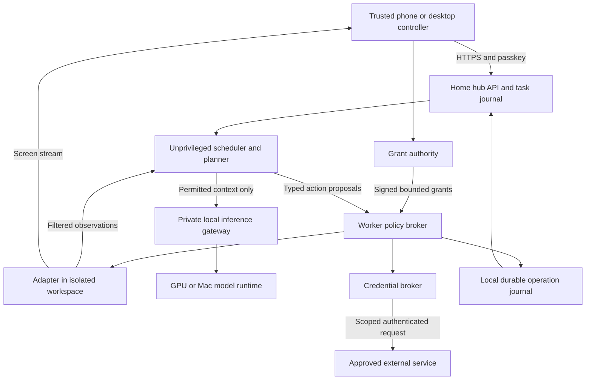
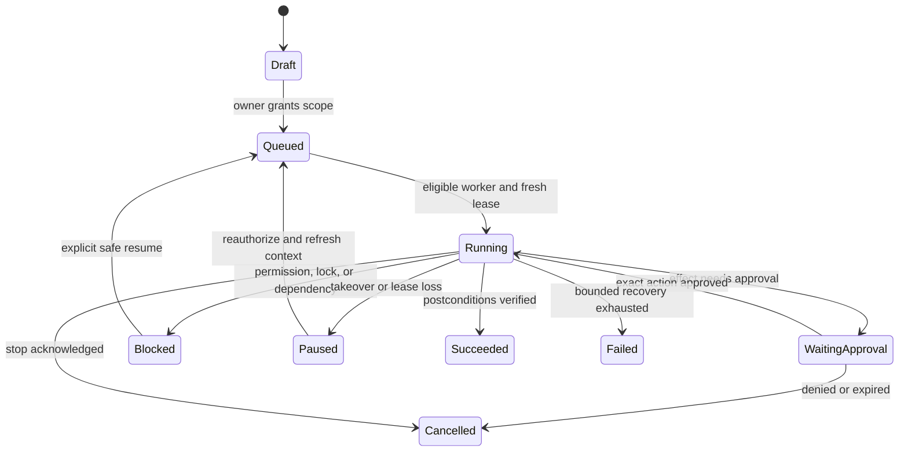

# Technical architecture

The proposed system separates planning, authorization, and execution. A model suggests actions; a device-local broker decides whether an action is permitted; an adapter executes it and returns evidence. Start with a small modular system, not Kubernetes or a new operating system.

**Implementation update:** the [local foundation](14-local-foundation.md) contains a React controller and Go fixture service with a bounded JSON journal. Production components below remain proposed. The owner's first deployment is now [Mac mini with iPhone/iPad controllers](15-mac-first.md); no Linux GPU box is available. Adapt isolation and inference after confirming the Mac hardware rather than treating the Linux reference topology as an installation requirement.

## Components and trust boundaries



The diagram shows application relationships; all cross-device edges traverse the private overlay and authenticated application channels. The grant authority and scheduler must have distinct OS principals, keys, storage access, and IPC policy. Different process names or containers sharing writable volumes do not create this boundary.

| Component | Proposed implementation | Responsibility |
| --- | --- | --- |
| Controller | TypeScript, React, responsive PWA | Fleet, tasks, approvals, evidence, takeover |
| Hub and scheduler | Go, PostgreSQL | Enrollment, state machine, outbox, schedules, API |
| Worker and policy broker | Rust, narrow typed IPC | Device identity, hard limits, authorization, watchdog, journals |
| Native adapters | Swift on macOS; C# on Windows; Rust on Linux | Use supported capture, accessibility, and input APIs |
| Runtime adapter | Existing runtime or small Python sidecar | Planning and model calls; no credential or policy keys |
| Inference | llama.cpp initially; vLLM/MLX behind adapters | Match runtime to hardware and model features |
| Workspace | Apple Virtualization Linux guest for the Mac mini; KVM/QEMU on Linux hosts | Disposable execution, restricted mounts and networking; hardware validation required |

This is a proposed stack. M0 compares existing adapters before adding languages or writing native integrations. A runtime adapter must translate into broker-approved actions; it cannot expose a bypassing shell or tool socket.

## Deployment and networking

**First deployment topology:** the Mac mini hosts the hub, an inference candidate and a separately bounded workspace/helper; iPhone/iPad provide controllers. The MacBook can join later. The original Linux worker/private inference host topology remains an alternative. The hub stores metadata and schedules; worker journals must survive a hub restart. Production encrypted artifact storage remains planned; the local fixture journal is plaintext. Avoid Redis, distributed databases, and a second queue until measurements justify them.

Use a WireGuard overlay coordinated by self-hosted Headscale for the first technical-user installation. A publicly reachable coordination/DERP service may run on a small owner-operated VPS when home CGNAT prevents inbound access. Devices initiate connections outbound; no home router port forwarding for worker services. Headscale targets personal or small-organization networks. [Headscale scope](https://github.com/juanfont/headscale).

A WireGuard tunnel protects peer traffic; it does not authorize application actions. Worker RPC uses mutually authenticated TLS with application device identity. Browser traffic uses HTTPS and passkeys. Do not expose SSH, VNC, RDP, CDP, inference ports, or the hub database to the public Internet. No LAN-wide subnet route by default. Explicit ACLs allow controller→hub, hub/authority→broker, planner→inference, and a narrowly authorized controller↔worker media/input path. Bind that final path to a current session grant and revoke input when its lease ends; use the negotiated, restricted ports, not unrestricted peer access.

For an early live view, test a direct WebRTC connection over the overlay, with authenticated signaling and a destination-bound input channel. Later, ICE/STUN/TURN can make network paths more flexible. TURN is a packet relay, not a device identity or permission system; DERP and TURN serve different protocol layers. If signaling or a gateway terminates a session, it may become a trusted content endpoint. Avoid an end-to-end encryption claim unless the exact termination and peer authentication paths are audited. [WebRTC security architecture](https://www.rfc-editor.org/rfc/rfc8827).

Loss of worker-to-authority connectivity pauses effects after lease expiry. Closing the phone app does not stop an authorized run while the home worker and authority can still communicate. Remote operation still depends on electricity, home uplink, permitted VPN transport, worker readiness, and a trusted controller. An arbitrary borrowed browser is not an equivalent secure controller.

## Device and task protocol

Version each schema and reject unknown effectful verbs. Capability negotiation returns supported adapters, OS/session state, permission status, isolation mode, model features, and resource limits—not merely “online.”

Core records: `Device`, `DeviceIdentity`, `Workspace`, `Task`, `Run`, `Step`, `Grant`, `Approval`, `CredentialRef`, `Observation`, `Artifact`, `AuditEvent`, `Schedule`.

Every action envelope includes:

```text
protocol_version, workspace_id, task_id, run_id, operation_id,
device_id, session_epoch, grant_id, policy_version,
typed_action, canonical_arguments_hash, observation_id,
expected_target, issued_at, expires_at, sequence, signature
```

Bind approvals to exact canonical arguments and target identity; a signed natural-language summary is insufficient. The broker verifies identity, local policy ceiling, current revocation state, grant and lease expiry, budgets, action schema, and fresh target preconditions before starting an effect. Use standard signing libraries and canonical serialization; include independent protocol review before remote writes.

Owner grants last for an explicitly chosen task or schedule window. Execution leases last at most **30 seconds**, renew around every **10 seconds**, and never extend the owner grant. After expiry, admit no new broker actions or input. Already-running commands may still produce side effects until the watchdog terminates managed execution, within **35 seconds** after the last valid renewal in the reference test environment. These are proposed requirements; arbitrary shell execution is not an individually mediated syscall stream.

Persist consumed operation IDs and grant usage before dispatch. Bind leases to a fresh boot/session epoch and suspend-inclusive elapsed time; invalidate them on resume unless that clock behavior is verified. Ordinary Linux `CLOCK_MONOTONIC` excludes suspend, so it is insufficient by itself. Restarting cannot revive a lease. Renewals require a live authenticated challenge and must not be stockpiled. Recheck revocation and deadline before each step and at commit points where available. [Linux clock behavior](https://man7.org/linux/man-pages/man2/clock_gettime.2.html).

## Durable execution



Transport is at-least-once; execution is deduplicated through a local write-ahead journal and provider idempotency keys where supported. For an external effect with an uncertain response, mark `outcome_unknown` and reconcile against the destination. Never blindly retry a purchase, message, upload, or GUI submission. Exactly-once side effects cannot be promised across arbitrary external applications.

Use transactional outbox delivery between the hub database and workers. Recover state from accepted runs, not a model conversation. Enforce an exclusive desktop lease with a fencing epoch so a stale run cannot keep typing after takeover. A new controller changes ownership only after the broker acknowledges the fence.

Schedules use UTC internally plus an explicit user timezone and daylight-saving policy. Debounce events, deduplicate triggers, enforce concurrency caps, and skip or request review for missed runs instead of replaying an unbounded backlog. No continuously looping LLM when idle.

## Screen context loop

Prefer typed service API → browser DOM/accessibility → native accessibility → vision and coordinates. A tool's narrower, verifiable interface takes priority over simulated clicks.

1. Collect a permitted window crop, accessibility tree, application identity, URL origin when trustworthy, display transform, and timestamp.
2. Filter secret regions, notifications, clipboard, unrelated windows, and unapproved files before inference.
3. Plan a typed action with a target, preconditions, and intended postcondition.
4. Authorize locally, reacquire target state, then execute one bounded action.
5. Observe again and verify the postcondition. After two unsuccessful recovery attempts, pause for the user.

Pixels, OCR, web content, accessibility labels, and retrieved memory are untrusted data. They cannot introduce permissions. Whole-screen control is inherently coarse; it cannot enforce a reliable “only draft, never send” policy inside a fully authenticated app. Prefer narrow connectors or supervised takeover for such boundaries.

## Local inference and resource routing

Treat inference location and execution location as independent selections. A Mac screenshot sent to a home GPU box leaves the Mac; the policy must permit that device as a data recipient. Local-only means no hosted inference fallback, telemetry payloads, or cloud OCR. A model failure blocks the run instead of silently routing private context to a hosted API.

Candidates: llama.cpp for quantized CPU/Metal/CUDA deployments, vLLM for supported GPU workloads, and MLX for supported Apple silicon models. Adapter compatibility, structured tool output, vision support, quantization, and model terms must be checked together. [llama.cpp](https://github.com/ggml-org/llama.cpp), [vLLM](https://docs.vllm.ai/en/latest/), [MLX examples](https://github.com/ml-explore/mlx-examples).

For evaluation, include an openly licensed vision model such as Qwen3-VL-8B-Instruct and a code/text model selected at M0. This is a reproducible baseline candidate, not a claim of best current performance. Its published card specifies Apache-2.0. Pin revision, tokenizer, prompt template, quantization and runtime. [Model card](https://huggingface.co/Qwen/Qwen3-VL-8B-Instruct).

Approximate weight storage is `parameter_count × bits_per_weight / 8`: an 8B 4-bit model has a theoretical 4 GB weight payload before scales, vision components, caches, and runtime overhead. Budget memory from a measured load test, not that formula alone. Start testing with a 16–24 GB GPU or a 32–64 GB unified-memory Mac; these are lab planning assumptions, not hardware guarantees or buying advice. Do not shard models over a home WAN in v1.

Admission control reserves memory, limits concurrent runs, caps context/images, and preserves headroom. The inference service receives neither broker sockets nor vault keys. Protect it behind an authenticated allowlist gateway; vLLM's API-key option alone does not protect every endpoint. [vLLM security](https://docs.vllm.ai/en/latest/usage/security/).
