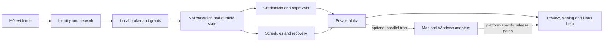

# Milestones and implementation backlog

This is a proposed delivery plan, not a record of completed engineering. Dependencies and exit evidence govern advancement; calendar dates do not override failed security gates.

## Current implementation and hardware

The [local foundation](14-local-foundation.md) now implements the React controller, Go task journal, fixed fixture runner, report approval and automated tests. It supports M0/UI development; M0 and M1 are still open. The [mobile extension](16-mobile-controller.md) adds an opt-in private gateway, browser pairing, expiry and revocation. Physical Safari/Tailscale tests remain pending; real device and model integration are not implemented.

The owner's available fleet is **Mac mini, MacBook, iPhone and iPad**, with no Linux GPU box. The [Mac-first track](15-mac-first.md) makes the Mac mini the first hub/worker and the phones/tablets controllers. Confirm chip, RAM and macOS before model/VM selection. Run the same identity, isolation, authorization and recovery gates on this deployment; the original Linux reference sequence below is not a hardware purchase requirement.

Planning assumption: four experienced engineers across systems, backend, UI and agent integration, plus part-time product/design and independent security review. Allow roughly **24–28 weeks** to a constrained public beta; a solo implementation is more likely **9–15 months** and should reduce platform scope. Re-estimate after M0. Windows and public mobile distribution can extend the schedule.

## Milestone sequence

| Milestone | Indicative window | Deliverable | Exit evidence |
| --- | --- | --- | --- |
| M0 Feasibility and decisions | Weeks 1–2 | Mac inventory, threat model, adapter/model/VM bakeoff, user interviews | Read-only capture on target Mac; isolated guest input spike; verified session limits; pinned component/license decision |
| M1 Trusted foundation | Weeks 3–5 | Single owner, pairing, identity, private transport, read-only worker | Wrong identity, replay, lost key and revocation tests pass; remote observation only |
| M2 Controlled execution | Weeks 6–9 | Managed VM, typed broker, grants, durable runs, watchdog | Local model completes fixture task; scope escapes denied; reconnect cannot duplicate effects |
| M3 Useful private alpha | Weeks 10–13 | Mobile UI, approvals, credential broker, schedules, artifacts, takeover | End-to-end demo and credential canary suite pass; 72-hour soak; three to five consenting testers |
| M4 Optional desktop expansion | Weeks 14–18, parallel or deferred | Supervised macOS adapter, then Windows adapter | Published OS/session matrix; permissions and lock/reboot behavior pass on actual hardware |
| M5 Hardened beta | Weeks 19–24 | Signed updater, recovery, diagnostics, accessibility, independent review | Seven-day pilot; release gates in testing plan; no unresolved blocking high/critical findings |
| M6 Release buffer | Weeks 25–28 | Fix findings, packaging, install docs, public project governance | Maintainers sign release evidence; supported scope and limitations published |

If M0 shows that an existing runtime satisfies most requirements, implement Appy as an integration and UI layer. If desktop permissions cannot be reliably bounded, ship Linux workspaces first and keep host control experimental. Do not delay a defensible release to claim universal device control.

## Dependency map

UI work and fixture design can proceed beside M1. No real account automation begins before M2 authorization tests. M4 is not a prerequisite for a Linux-only beta; a native adapter joins a supported release only after its own gates pass. A failure in a platform adapter does not weaken the common policy contract.

## Prioritized TODOs

Each item needs an assignee, reviewed change, linked test and evidence artifact when implementation begins. Role names are suggested ownership, not actual assignments.

### M0: answer the expensive questions

- [ ] **P01 · Product:** interview 8–12 AI builders; rank their three highest-value remote tasks and tolerance for approvals.
- [ ] **P02 · Systems:** inventory GPU/VRAM, OS/build, RAM, display, power, router/CGNAT, uplink and available test devices; record privacy constraints.
- [ ] **P03 · Systems:** compare Cua Driver, MeshCentral and a minimal native adapter for capture, input, permission behavior and license compatibility.
- [ ] **P04 · Agent:** compare OpenClaw integration with a minimal runtime against the same five tasks; prove no alternative runtime tool/paired-node invocation path can bypass the broker, including use of a stolen runtime identity.
- [ ] **P05 · Agent:** benchmark two local model configurations on 30 representative task attempts; record memory, latency, task success and unsafe proposals.
- [ ] **P06 · Security:** review trust boundaries and owner recovery; choose identity/signing libraries and define canonical action schemas.
- [ ] **P07 · Maintainers:** select project license, supported versions, dependency digests, vulnerability reporting channel and contributor process.

### M1–M2: earn permission to execute

- [ ] **F01 · Backend:** implement single-owner passkey sessions, CSRF/origin checks, recovery and device inventory.
- [ ] **F02 · Systems:** implement locally initiated enrollment, key pinning, mutual authentication, rotation and device removal.
- [ ] **F03 · Systems:** deploy reproducible overlay/relay configuration; verify cellular/CGNAT/UDP-blocked connectivity without public worker ports.
- [ ] **F04 · Security:** implement separate-principal broker/issuer/scheduler, immutable local policy ceiling, default-deny schema validation and durable nonce ledger.
- [ ] **F05 · Systems:** implement 30-second leases, renewal challenges, fencing epochs, watchdog and truthful stop acknowledgements.
- [ ] **F06 · Systems:** provision disposable VM images with restricted mounts and egress; prohibit host sockets and credentials.
- [ ] **F07 · Backend:** implement transactional outbox, run state machine, bounded retries, idempotency and unknown-outcome reconciliation.
- [ ] **F08 · Agent:** implement filtered observations, typed tool proposals, pre/postcondition verification and local-only model routing.

### M3: make the system useful

- [ ] **A01 · UI:** implement fleet/task screens, scope preview, readiness, approval expiry, evidence, keyboard navigation and mobile layout.
- [ ] **A02 · Security:** implement one narrowly scoped OAuth connector, optional secret-store adapter, canary testing and provider-side revocation.
- [ ] **A03 · Systems/UI:** implement manual takeover, input fencing, private login observation suspension and explicit hand-back.
- [ ] **A04 · Backend:** implement schedules, missed-run policy, event deduplication, budgets and notification privacy.
- [ ] **A05 · Backend:** implement artifact integrity, authorized download, retention, backup and restore without resurrecting grants.
- [ ] **A06 · QA:** execute 20 user workflows five times each and a 72-hour fault-injected soak; publish results with failure categories.

### M4–M6: expand and release

- [ ] **R01 · Systems:** macOS signed per-user helper; test TCC, AX, capture, lock/logout/sleep/FileVault, multi-display and update identity.
- [ ] **R02 · Systems:** Windows per-user adapter; test UIPI/UAC boundaries, session isolation, RDP disconnect and authorized IPC.
- [ ] **R03 · Release:** publish signed artifacts, SBOMs and provenance; implement rollback/freeze protection and key-rotation recovery.
- [ ] **R04 · QA:** add nightly native hardware runs, parser fuzzing, fault injection and adversarial prompt/content corpus.
- [ ] **R05 · Security:** commission independent review of enrollment, broker, credentials, web controller and updater; fix and retest findings.
- [ ] **R06 · Maintainers:** establish support ownership, incident process, tested upgrade/restore guide and transparent compatibility matrix.
- [ ] **R07 · Product/QA:** complete seven-day field pilot, accessibility review and install usability tests before public beta.

## First demonstrable workflow

Target workflow after the identity/isolation gates: from the trusted iPhone on cellular, connect to the private Mac mini hub; start “analyze this fixture repository and produce a test report”; route inference to a measured local model on the mini; execute inside its validated isolated workspace; review a permitted file write; request an upload to a fixture service; approve the exact artifact; view the receipt. Repeat with an injected malicious README, a cut network, a revoked grant and a worker restart. The current local foundation proves only the fixed-fixture task/review/download portion; it has no model, VM, verified cellular access or external upload. No real customer data or personal credentials are needed.

## Costs and scope control

Track engineer time, external review, CI machines, signing/distribution, storage, relay bandwidth and electricity separately. Existing hardware can reduce purchases but does not remove operating costs. A stream at 4 Mbit/s transfers roughly 1.8 GB per hour; use event-driven observations and start video only for takeover. Energy is `average watts × hours / 1000` kWh; measure rather than assume GPU idle and active power.

Defer multi-tenant hosting, distributed model sharding, mobile worker automation, plugin marketplace and automated account recovery. Each adds a distinct threat model. Support five stable workflows before fifty fragile integrations.
